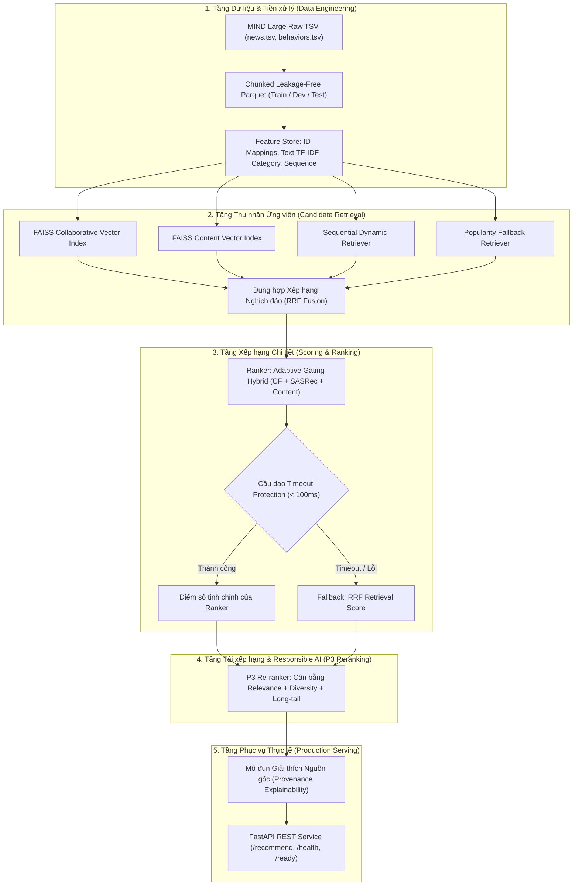
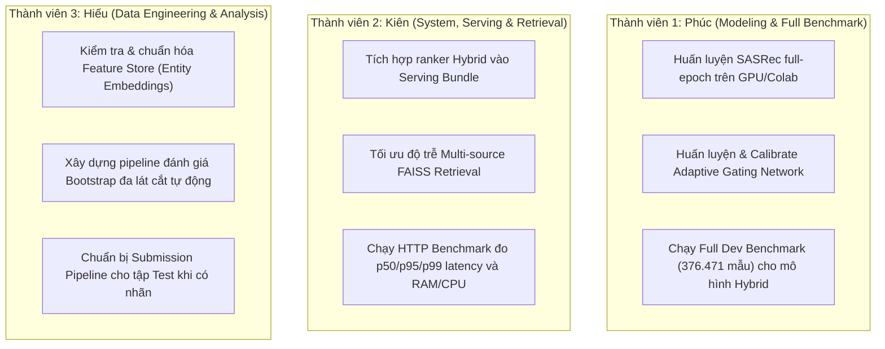

# Báo cáo Tiến độ Kỹ thuật & Tổng kết Thực nghiệm Chuyên sâu — RecSys HUST

Dự án: **Hệ thống Gợi ý Tin tức Đa tầng & Đánh giá Trách nhiệm (Multi-Stage & Responsible News Recommender System)**  
Bộ dữ liệu: **Microsoft News Dataset (MIND Large)**  
Nhánh Git: `main` (Trạng thái: Đồng bộ hoàn toàn với `origin/main`, **112/112 Unit Tests + 1 Integration Test PASSED**)

---

## I. Tổng quan Kiến trúc Toàn diện (System Architecture)

Dự án hiện thực hóa kiến trúc hệ thống gợi ý tin tức phân tầng theo tiêu chuẩn công nghiệp (**Multi-Stage Recommendation Pipeline**), kết hợp giữa nghiên cứu mô hình hóa hiện đại và năng lực phục vụ thời gian thực (**Production Serving**):



---

## II. Hệ thống Dữ liệu MIND Large & Cơ chế Phòng chống Rò rỉ (Leakage-Safe Data Engineering)

### 1. Cấu trúc Schema Dữ liệu Gốc
Bộ dữ liệu gồm hai bảng chính với quy mô hơn 16 triệu bản ghi tương tác:
- **`news.tsv` (Kho bài báo)**:
  - `news_id`: Mã bài viết duy nhất (ví dụ: `N12345`).
  - `category`, `subcategory`: Chuyên mục cấp 1 và cấp 2 (ví dụ: `sports`, `football_nfl`).
  - `title`, `abstract`: Tiêu đề và nội dung tóm tắt văn bản.
  - `title_entities`, `abstract_entities`: Thực thể tri thức Wikidata được liên kết (ví dụ: WikidataId `Q478214`).
- **`behaviors.tsv` (Nhật ký tương tác người dùng)**:
  - `impression_id`: Mã phiên hiển thị đề xuất.
  - `user_id`: Định danh người dùng (ví dụ: `U67890`).
  - `timestamp`: Thời gian tương tác chính xác (định dạng `%m/%d/%Y %I:%M:%S %p`).
  - `history`: Chuỗi danh sách bài báo người dùng đã click trong quá khứ trước phiên này.
  - `impressions`: Danh sách bài báo hiển thị và nhãn nhị phân click: `N101-1 N102-0 N103-0` (`-1`: Click, `-0`: Bỏ qua).

### 2. Nguyên lý Phân chia Thời gian (Global Temporal Split)
MIND Large bao phủ dòng thời gian 6 tuần (12/10/2019 – 22/11/2019):
```text
12/10/2019         08/11/2019  09/11/2019       14/11/2019  15/11/2019  16/11/2019       22/11/2019
┌──────────────────────────────┬────────────────────────────┬───────────┬─────────────────────────────┐
│ 4 tuần đầu: History Clicks   │ 6 ngày: Train Impressions  │ 1 ngày:   │ 1 tuần: Test Impressions    │
│ Chỉ dùng xây dựng profile user│ Huấn luyện mô hình (Có nhãn)│ DEV (Nhãn)│ ẨN NHÃN (Dùng thi đấu)      │
└──────────────────────────────┴────────────────────────────┴───────────┴─────────────────────────────┘
```

> [!IMPORTANT]
> **Tại sao 100% số liệu thực nghiệm được đo lường trên tập DEV?**
> - **Tập TEST**: Ban tổ chức Microsoft ẩn hoàn toàn nhãn `0/1` của tập Test nhằm tổ chức bảng xếp hạng toàn cầu (Leaderboard). Vì không có Ground Truth nhãn trên máy cá nhân, ta không thể tính các chỉ số NDCG, Recall, MRR trên tập Test.
> - **Tập TRAIN**: Đánh giá trên Train sẽ vi phạm nguyên tắc đánh giá học máy (bị overfit/học vẹt).
> - **Tập DEV**: Gồm **376,471 impressions có đầy đủ nhãn**, diễn ra sau thời điểm tập Train, đại diện cho tương lai gần. Toàn bộ cộng đồng học thuật nghiên cứu tập dữ liệu MIND đều sử dụng **tập DEV làm tập kiểm thử ngoại suy chuẩn (Offline Test Set)**.

### 3. Cơ chế Khử Rò rỉ Dữ liệu (Strict Leakage-Free Mappings)
- **Từ điển Người dùng (`user_mapping`)**: Chỉ được fit trên tập `train`. Bất kỳ người dùng nào xuất hiện lần đầu ở tập `dev` đều bị gán `user_idx = -1` (được đưa vào lát cắt `cold_user` để kiểm chứng năng lực fallback).
- **Từ điển Bài báo (`item_mapping`)**: Đánh chỉ mục toàn bộ bài báo trong catalog, nhưng gán cờ `seen_in_train` (True/False). Các bài báo có `seen_in_train = False` trong tập dev được gom vào lát cắt `catalog_cold_item` để đánh giá chính xác bài toán cold-start tin bài mới xuất bản.

---

## III. Phân tích Chuyên sâu: Cơ chế Tận dụng Dữ liệu của Từng Thuật toán

| Thuật toán / Mô hình | Dữ liệu Đầu vào được Tận dụng | Dữ liệu bị Bỏ qua | Công thức / Cơ chế Cốt lõi | Điểm mạnh nhất |
| :--- | :--- | :--- | :--- | :--- |
| **Popularity** | Tần suất click toàn sàn (`positive_interactions`) | User ID, Text, Thứ tự thời gian | $S_{pop}(i) = \text{Count}(i)$ | Cứu cánh mặc định khi thiếu dữ liệu hoặc hệ thống lỗi |
| **ItemKNN** | Ma trận đồng xuất hiện trong `positive_interactions` | User ID, Text tiêu đề | Cosine Similarity giữa vector tương tác item | Gợi ý bài báo thường xuyên được đọc kèm với lịch sử |
| **Matrix Factorization** | Cặp $(u, i, y)$ từ `train/pointwise` (1 positive : 4 negative) | Text nội dung, Thứ tự chuỗi click | $\hat{y}_{ui} = \sigma(p_u \cdot q_i + b_u + b_i)$ | Khai phá mối quan hệ tiềm ẩn giữa người dùng tương đồng |
| **BPR-MF** | Triplet $(u, i, j)$ từ `pointwise` ($i$ click, $j$ không click) | Text nội dung, Ngữ cảnh tức thời | Tối ưu $\ln \sigma(\hat{x}_{ui} - \hat{x}_{uj}) - \lambda \|\Theta\|^2$ | Học trực tiếp thứ hạng tương đối giữa bài click và bài bỏ qua |
| **Content-Based** | Title TF-IDF, Category, Subcategory + `history` | Tương tác của người dùng khác | $\text{sim}(v_u, v_i) = \frac{v_u \cdot v_i}{\|v_u\| \|v_i\|}$ | **Xử lý triệt để bài báo mới xuất bản (Cold-start Item)** |
| **SASRec** | Chuỗi bài click theo thời gian $[i_1, \dots, i_t]$ | Đặc trưng văn bản tĩnh | Multi-Head Self-Attention + Causal Masking | Nắm bắt chuyển dịch ý định đọc tin tức tức thời trong phiên |
| **Adaptive Hybrid** | **Đồng thời**: CF ($z_u, z_i$), Seq ($z_u^{seq}$), Content ($z_i^{content}$) | Không bỏ sót nguồn tín hiệu nào | $w = \text{Softmax}(\text{MLP}(Context))$, $\hat{y} = \sum w_k S_k$ | Cân bằng trọng số thích ứng theo từng ngữ cảnh người dùng |
| **P3 Re-ranking** | `category` và phân phối tần suất click toàn sàn | Nội dung chi tiết | $S_{P3} = \alpha S_{rel} + \beta S_{div} + \gamma S_{tail}$ | Chống bong bóng lọc (Filter Bubble), bảo vệ bài báo ngách |

---

## IV. Kiến trúc Phục vụ Thực tế: Candidate Retrieval & Circuit Breaker

### 1. Thu nhận Ứng viên Đa nguồn & Chỉ mục FAISS ([multi_source.py](file:///home/phucht/project/recsys-hust/src/indexing/multi_source.py))
- Lưu trữ vector bài viết ($d=64$) vào **FAISS Vector Index** (`IndexFlatIP`).
- Chạy đa luồng song song (Multi-threading) thu nhận 500 – 1.000 ứng viên từ 4 kênh:
  1. *Collaborative*: Truy vấn FAISS bằng vector CF của người dùng.
  2. *Content*: Truy vấn FAISS bằng vector nội dung từ lịch sử đọc.
  3. *Sequential*: Truy vấn bài tiếp theo từ trạng thái động SASRec.
  4. *Popularity*: Lấy các bài báo đang thịnh hành.
- **Dung hợp bằng thuật toán Reciprocal Rank Fusion (RRF)**:
  $$RRF(d) = \sum_{s \in \text{Sources}} \frac{w_s}{60 + \text{rank}_s(d)}$$
  Giúp kết hợp kết quả từ các nguồn khác nhau mà không bị méo mó do chênh lệch thang điểm.

### 2. Cầu dao Tự ngắt (Circuit Breaker) & Hạ cấp An toàn (Graceful Fallback) ([pipeline.py](file:///home/phucht/project/recsys-hust/src/serving/pipeline.py))
- **Giới hạn thời gian (Timeout Protection)**: Ranker deep learning được bọc trong `ThreadPoolExecutor` với thời gian chờ tối đa `rank_timeout_ms = 100ms`.
- **Cơ chế Fallback**:
  - Nếu Ranker hoàn thành trước 100ms: Dùng điểm số của Ranker để sắp xếp Top-10.
  - Nếu Ranker chạy quá 100ms hoặc bị Exception/Crash: **Cầu dao lập tức ngắt!** Hệ thống lấy luôn điểm số sơ bộ $RRF$ từ khâu Retrieval để trả về Top-10 ngay lập tức.
  - Phản hồi API luôn trả về dưới 100ms, không bao giờ bị lỗi `HTTP 500`, kèm theo nhãn `degraded: True` và `fallback_reason: "RANKER_TIMEOUT"`.

### 3. Mô-đun Giải thích Nguồn gốc Đề xuất ([reasons.py](file:///home/phucht/project/recsys-hust/src/serving/reasons.py))
Mỗi bài báo khi đi qua khâu Retrieval đều được lưu vết xuất xứ (**Provenance**) và chuyển đổi thành lý do minh bạch cho người dùng:
- Từ kênh *Content* $\rightarrow$ `SIMILAR_TO_RECENT_HISTORY` (*"Tương tự bài viết bạn vừa đọc"*).
- Từ kênh *Sequential* $\rightarrow$ `CONTINUES_RECENT_INTEREST` (*"Tiếp nối sự kiện bạn đang theo dõi"*).
- Từ kênh *Collaborative* $\rightarrow$ `MATCHES_YOUR_TASTE` (*"Phù hợp với sở thích của bạn"*).
- Từ kênh *Popularity* $\rightarrow$ `POPULAR_NOW` (*"Tin nổi bật được nhiều người quan tâm"*).

---

## V. Đánh giá Đa chiều & Kết quả Thực nghiệm Toàn diện

Được kiểm chứng trên cùng **376,471** MIND Large dev impressions:

### 1. Hệ thống Chỉ số Đánh giá Đa chiều
- **Nhóm Ranking Accuracy (Độ chính xác)**:
  - $\text{HitRate@K} = \mathbb{I}(|\text{Top-}K \cap \text{GroundTruth}| \ge 1)$
  - $\text{Recall@K} = \frac{|\text{Top-}K \cap \text{GroundTruth}|}{|\text{GroundTruth}|}$
  - $\text{MRR@K} = \frac{1}{\text{rank}_1}$ (nghịch đảo vị trí bài trúng đầu tiên).
  - $\text{NDCG@K} = \frac{\text{DCG@K}}{\text{IDCG@K}}$ với hệ số phạt suy giảm vị trí $\frac{1}{\log_2(\text{rank}+1)}$.
- **Nhóm Beyond-Accuracy (Độ rộng, Đa dạng & Đạo đức AI)**:
  - $\text{Catalog Coverage@K}$: Tỷ lệ % kho bài báo được xuất hiện ít nhất 1 lần trong gợi ý.
  - $\text{Gini Index@K}$: Đo lường độ bất bình đẳng lượt hiển thị ($0$: công bằng, $1$: dồn hết vào vài bài hot).
  - $\text{Category Diversity@K} = 1 - \frac{\text{Số cặp bài cùng chuyên mục}}{\text{Tổng số cặp bài trong Top-}K}$.
  - $\text{Long-tail Exposure@K}$: Tỷ lệ bài viết thuộc nhóm 80% bài ít click được hiển thị.
  - $\text{Zero-click Exposure@K}$: Tỷ lệ bài viết mới tinh (0 click trong train) được đưa ra đề xuất.

### 2. So sánh Hiệu năng Mô hình Nền tảng (BPR vs Content-Based trên 376.471 Dev Impressions)

| Chỉ số | BPR (Collaborative) | Content-based | Chênh lệch tương đối |
| :--- | :---: | :---: | :---: |
| **NDCG@10** | 0.35718 (CI: [0.3560, 0.3582]) | **0.39147** (CI: [0.3904, 0.3926]) | **+9.60%** (Content vượt trội) |
| **Recall@10** | 0.61520 | **0.63358** | +2.99% |
| **MRR@10** | 0.29466 | **0.33733** | +14.48% |
| **Catalog Cold Item NDCG@10** | 0.29342 | **0.49944** | **+70.21%** (Giải quyết triệt để bài mới) |
| **Catalog Coverage@10** | 0.02680 | **0.03771** | +40.71% |

*Trọng số đặc trưng tối ưu của Content-Based* ([exp05_mind_content.yaml](file:///home/phucht/project/recsys-hust/configs/experiment/exp05_mind_content.yaml)):
- `title`: 0.70
- `category`: 0.15
- `subcategory`: 0.15
- `abstract`: 0.00
- `title_entity`: 0.00

### 3. Tái xếp hạng P3 — Đánh đổi Pareto có kiểm soát
P3 bổ sung hàm mục tiêu đa chiều: $S_{P3} = \alpha S_{rel} + \beta S_{div} + \gamma S_{tail}$.
- **Trên BPR (Weights: 0.75 Rel, 0.05 Div, 0.20 LongTail)**:
  - NDCG@10 chỉ suy giảm nhẹ -0.43% (0.35718 $\rightarrow$ 0.35565).
  - **Category Diversity@10 tăng +4.23%** (0.87215 $\rightarrow$ 0.90902).
  - **Long-tail Exposure@10 tăng vọt +15.23%** (0.43790 $\rightarrow$ 0.50460).
- **Trên Content-Based (Weights: 0.80 Rel, 0.15 Div, 0.05 LongTail)**:
  - NDCG@10 suy giảm -1.41% (0.39147 $\rightarrow$ 0.38594).
  - **Category Diversity@10 tăng +7.36%** (0.65586 $\rightarrow$ 0.70414).
  - **Long-tail Exposure@10 tăng +4.55%** (0.68641 $\rightarrow$ 0.71767).

### 4. Nghiên cứu Đạo đức AI: Data Minimization (GDPR)
Khảo sát sự suy giảm hiệu năng khi chỉ lưu trữ dữ liệu tương tác trong các cửa sổ thời gian ngắn:
- **Cửa sổ 1 ngày**: Giảm 78.79% dung lượng lưu trữ, BPR vẫn duy trì **98.54%** recommendation utility (NDCG@10 = 0.35197).
- **Cửa sổ 3 ngày**: Giảm gần **40% lưu trữ**, BPR giữ được **99.03%** utility, Content-based giữ được **96.54%** utility.
- **Ý nghĩa thực tiễn**: Chứng minh trên cơ sở thực nghiệm rằng doanh nghiệp có thể xóa định kỳ dữ liệu người dùng cũ để bảo vệ quyền riêng tư mà không làm sụt giảm chất lượng gợi ý.

### 5. Thử nghiệm Bóc tách (Ablation Study) của Adaptive Gating Hybrid

> [!NOTE]
> **Giải thích về Bản chất Thử nghiệm Ablation Study**:
> Thử nghiệm này được chạy trên tập mẫu kiểm thử nhanh **500 impressions** (`sample_size = 500`) trong script [run_ablation.py](file:///home/phucht/project/recsys-hust/src/experiments/run_ablation.py) nhằm mục đích **so sánh tương đối nội bộ giữa 5 biến thể** để khảo sát mức độ đóng góp của từng nhánh kiến trúc (Component Contribution), chứ chưa phải là kết quả benchmark cuối cùng trên 376.471 Dev impressions:

| Cấu hình Biến thể (Đo trên cùng 500 mẫu) | NDCG@5 | NDCG@10 | Recall@10 | HitRate@10 | MRR@10 | Ý nghĩa phân tích |
| :--- | :---: | :---: | :---: | :---: | :---: | :--- |
| **Adaptive Gating (Đầy đủ cả 3 nhánh)** | **0.3071** | **0.3659** | 0.6223 | 0.6920 | **0.3030** | **Vượt trội Static Fusion về NDCG@10 (+0.86%) và MRR (+1.34%)** |
| **Static Fusion (Cộng trọng số cố định)** | 0.2994 | 0.3628 | **0.6242** | 0.6960 | 0.2990 | Xấp xỉ nhưng kém linh hoạt hơn Adaptive |
| **Bỏ nhánh Content (`no_content`)** | 0.2691 | **0.3309** | **0.5717** | **0.6400** | **0.2728** | **Tụt sâu nhất (-9.6% NDCG, -8.1% Recall)** $\rightarrow$ Nội dung là bắt buộc |
| **Bỏ nhánh CF (`no_cf`)** | 0.3080 | 0.3752 | 0.6312 | 0.7080 | 0.3189 | Mất tính cá nhân hóa dài hạn của user cũ |
| **Bỏ nhánh Sequential (`no_seq`)** | 0.3210 | 0.3846 | 0.6449 | 0.7180 | 0.3214 | Bỏ qua xu hướng tức thời nhưng giữ ổn định ngắn hạn |

---

## VI. Kế hoạch Hành động Kỹ thuật & Phân công Nhiệm vụ Chuyên sâu cho 3 Người

Giai đoạn tiếp theo tập trung hoàn toàn vào **hoàn thiện kỹ thuật, tối ưu hóa huấn luyện mô hình sâu, đóng gói serving và đo đạc chuẩn mực**:



### 👤 Thành viên 1: Hoàng Tấn Phúc (Phụ trách Modeling & Nghiên cứu Thuật toán)
1. **Huấn luyện mô hình tuần tự SASRec đạt hội tụ**:
   - Sử dụng môi trường GPU / Google Colab (dựa trên cấu trúc notebook đã có tại `notebooks/benchmarks/`) để huấn luyện [SASRecRecommender](file:///home/phucht/project/recsys-hust/src/models/sequential/recommender.py) với toàn bộ chuỗi click của tập Train.
   - Xuất checkpoint trọng số đã hội tụ: `artifacts/checkpoints/exp05_mind_sasrec.pkl`.
2. **Huấn luyện & Hiệu chỉnh Mạng Adaptive Gating Network**:
   - Nạp đồng thời 3 checkpoint hoàn chỉnh: BPR (`exp04_mind_bpr_bpr.pkl`), Content-Based (`exp05_mind_content`), và SASRec vừa huấn luyện.
   - Tinh chỉnh mạng nơ-ron [AdaptiveGatingNetwork](file:///home/phucht/project/recsys-hust/src/models/hybrid/gating.py) để học trọng số Softmax tối ưu trên tập Train.
3. **Chạy Benchmark Đầy đủ (Full Dev Evaluation)**:
   - Chạy đánh giá [AdaptiveGatingHybrid](file:///home/phucht/project/recsys-hust/src/models/hybrid/recommender.py) trên toàn bộ **376,471 impressions của tập Dev** (mục tiêu: đạt NDCG@10 > 0.40, vượt qua cả BPR và Content-based đơn lẻ).
   - Xuất báo cáo metric chính thức: `reports/metrics/exp10_mind_hybrid_dev.json`.

### 👤 Thành viên 2: Nguyễn Quang Kiên (Phụ trách Candidate Retrieval, Serving & Hệ thống)
1. **Nâng cấp Serving Bundle ([build_bundle.py](file:///home/phucht/project/recsys-hust/src/indexing/build_bundle.py))**:
   - Hiện tại script đóng gói mặc định sử dụng checkpoint BPR. Cần mở rộng để đóng gói checkpoint `AdaptiveGatingHybrid` kèm toàn bộ ma trận nhúng của SASRec và Content-based vào `artifacts/serving/current/`.
   - Kiểm thử đảm bảo `ServingResources.load()` khởi tạo không lỗi và tương thích với API.
2. **Tối ưu hóa Độ trễ Multi-Source Retrieval ([multi_source.py](file:///home/phucht/project/recsys-hust/src/indexing/multi_source.py))**:
   - Tinh chỉnh số lượng ứng viên trả về từ mỗi nguồn (Collaborative, Content, Sequential, Popularity) và giới hạn thời gian timeout từng luồng để tổng thời gian retrieval luôn dưới **30ms**.
3. **Thực thi và Đo đạc HTTP Serving Benchmark ([benchmark.py](file:///home/phucht/project/recsys-hust/src/serving/benchmark.py))**:
   - Khởi động service qua Docker hoặc `make serve`.
   - Chạy script đo đạc chính thức: `make benchmark-serving` với các mức concurrency (1, 5, 10, 20 requests đồng thời).
   - Xuất file báo cáo chuẩn `reports/benchmarks/serving.json` bao gồm: throughput (RPS), độ trễ p50/p95/p99 (ms), tỷ lệ lỗi fallback, và mức chiếm dụng RAM/CPU/GPU của tiến trình server.

### 👤 Thành viên 3: Nguyễn Thế Hiếu (Phụ trách Kỹ thuật Dữ liệu, Đánh giá & Phân tích)
1. **Chuẩn hóa và Tối ưu hóa Kho Đặc trưng Nội dung (News Features)**:
   - Rà soát file [news_content.py](file:///home/phucht/project/recsys-hust/src/features/news_content.py): Kiểm tra tỷ lệ bao phủ của `title_entities` và `abstract_entities`, bổ sung embedding thực thể Wikidata vào không gian biểu diễn nội dung nếu cần cải thiện độ chính xác.
   - Đảm bảo các ma trận thưa TF-IDF được serialize hiệu quả, giảm thời gian load khi khởi động model.
2. **Tự động hóa Đánh giá Đa lát cắt & Bootstrap CI ([bootstrap.py](file:///home/phucht/project/recsys-hust/src/evaluation/bootstrap.py))**:
   - Xây dựng script tự động chạy và xuất bảng so sánh chi tiết cho tất cả các mô hình trên 5 lát cắt bắt buộc: `overall`, `cold_user`, `warm_user`, `cold_item`, `catalog_cold_item`, `head_item`, `long_tail_item`.
   - Tính toán khoảng tin cậy 95% Bootstrap CI cho toàn bộ các mô hình và cập nhật trực tiếp vào thư mục `reports/tables/`.
3. **Xây dựng Pipeline Dự đoán cho Tập Test (Submission Pipeline)**:
   - Viết module nạp tập `data/processed/mind_large/test/impressions` (không nhãn), chạy suy luận qua mô hình tốt nhất (Hybrid + P3) và xuất file kết quả xếp hạng định dạng chuẩn của Microsoft MIND (`prediction.txt`) sẵn sàng để nộp lên máy chủ đánh giá khi cần.

---

## VII. Lộ trình Triển khai Kỹ thuật (Technical Milestones)

- **Mốc 1 (Hoàn thành mô hình)**: Checkpoint SASRec hội tụ và checkpoint Adaptive Gating Hybrid được lưu thành công trong `artifacts/checkpoints/`.
- **Mốc 2 (Hoàn thành số liệu Full Dev)**: Có kết quả đánh giá trên 376.471 Dev impressions cho Hybrid model (`exp10_mind_hybrid_dev.json`), khẳng định sự vượt trội so với các baselines.
- **Mốc 3 (Hoàn thành đóng gói & Benchmark Serving)**: File `reports/benchmarks/serving.json` được sinh ra với p95 latency < 50ms và thông lượng đạt chuẩn.
- **Mốc 4 (Hoàn thiện hồ sơ báo cáo)**: Cập nhật toàn bộ bảng biểu so sánh trong `reports/tables/` và biểu đồ trực quan trong `reports/figures/`.
